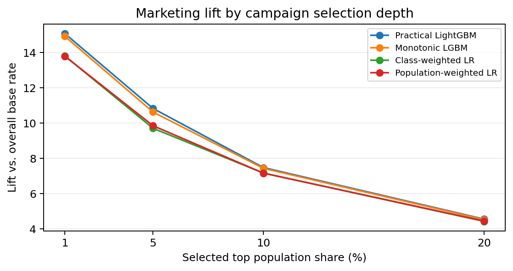
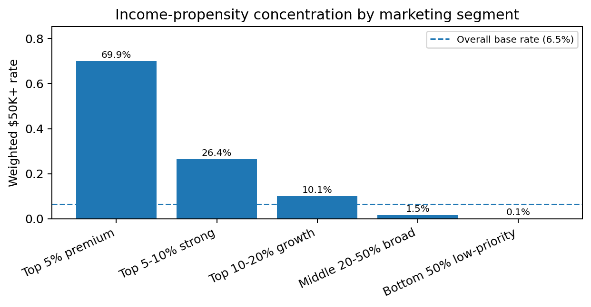

# Client Project Report: Income-Based Retail Marketing Targeting

## 1. Executive Summary

I recommend using the calibrated practical LightGBM model as the primary targeting model for this retail marketing use case. The model ranks individuals by estimated likelihood of annual income above $50K and converts the calibrated score into actionable campaign segments.

On the held-out test split, the recommended model achieved **AP = 0.6953**, **ROC-AUC = 0.9550**, **F1 = 0.6341**, **Brier score = 0.0327**, and **ECE10 = 0.0024**. It does not claim to meet every predefined stretch target: AP, F1, Top-5 precision, and Top-5 lift are near-target rather than fully passed. For marketing activation, the most important result is the top-of-list performance: the top 5% segment reached **69.9% precision** and **10.83x lift** over the weighted base rate of approximately **6.5%**.

The recommended business use is to start with the **Top 5% premium** segment for high-value outreach, expand to the **Top 10%** only after campaign-response measurement, and suppress the **Bottom 50%** from expensive outreach.

## 2. Business Problem and Data

The client wants to classify whether an individual has annual income above or below $50K and use the result for retail marketing. Because marketing budgets are limited, this is not only a binary classification problem. It is also a ranking and segmentation problem: the client needs to know which customers should be prioritized first, which customers should receive lower-cost outreach, and which customers should be excluded from high-cost campaigns.

The dataset contains census-style demographic, household, education, employment, and financial-signal variables. The target label is whether income is above $50K. The provided `weight` field is treated as a population/sample weight for training and evaluation, not as a predictive feature.

This framing is consistent with decision-oriented marketing analytics practice: the objective is not only to build a predictive model, but to connect model outputs to a business decision, a measurable operating policy, and a monitoring plan. In that context, I treat the score as a decision-support input for marketing prioritization, not as an automated eligibility, credit, employment, or other high-impact decision.

## 3. EDA and Preprocessing

The raw dataset contains **199,523 rows**, **40 input columns**, and a weighted population total of approximately **347.2M**. The unweighted positive rate is **6.2%** and the weighted positive rate is **6.4%**, so the modeling problem is imbalanced. Accuracy alone would be misleading because a model could look strong by predicting the majority class. For this reason, the evaluation emphasizes PR-curve metrics, top-k precision, lift, and calibration.

Preprocessing decisions:

- Categorical values were cleaned, missing/unknown-style categories were explicitly handled, and rare categories were grouped to reduce overfitting.
- Employment, lifecycle, and financial-signal features were added, including weeks worked, full-year worker flag, employer-size grouping, investment-signal indicators, and log-transformed financial variables.
- Population weights were used as sample weights and were not used as predictive input features.
- Preprocessing artifacts were fitted only on training data and then applied to calibration/test data to avoid leakage.
- A separate calibration split was used for sigmoid calibration and F1-threshold selection.

## 4. Classification Model

Four model routes were retained because they serve different review purposes. The table below separates the final scoring model from the challenger and benchmark models.

| Model route | Role in this report | Why included | Client-facing use |
|:--|:--|:--|:--|
| Practical LightGBM | Final recommended model | Best balance of ranking quality, calibration, and Top-K marketing lift | Default model for campaign prioritization and score-tier segmentation |
| Monotonic LightGBM | Business-constrained challenger | Tests whether directional business constraints can be added with limited performance loss | Use if the client prioritizes stronger directional business logic over maximum lift |
| Class-weighted logistic regression | Interpretable benchmark | Transparent linear benchmark with additional emphasis on the rare positive class | Use for coefficient-level review and sensitivity comparison |
| Population-weighted logistic regression | Transparent baseline | Simple weighted benchmark aligned with the provided sample/population weight | Use as the most transparent baseline for sanity checking |

| Model route | AP | PR-AUC | ROC-AUC | F1 | Brier | ECE10 | Top5 precision | Top5 lift |
|:--|--:|--:|--:|--:|--:|--:|--:|:--|
| Practical LightGBM | 0.6953 | 0.6952 | 0.9550 | 0.6341 | 0.0327 | 0.0024 | 0.6995 | 10.83x |
| Monotonic LightGBM | 0.6869 | 0.6868 | 0.9537 | 0.6258 | 0.0339 | 0.0060 | 0.6864 | 10.63x |
| Class-weighted LR | 0.6143 | 0.6145 | 0.9450 | 0.5792 | 0.0369 | 0.0044 | 0.6267 | 9.71x |
| Population-weighted LR | 0.6237 | 0.6236 | 0.9458 | 0.5757 | 0.0365 | 0.0035 | 0.6362 | 9.85x |

The final recommended model is **Practical LightGBM (REFERENCE_practical_LightGBM)** because it provides the strongest overall combination of ranking quality, probability quality, and top-of-list marketing lift. Its training recipe uses a LightGBM classifier with 500 estimators, learning rate 0.035, positive-class weighting with power 0.35, population weights, and sigmoid calibration on a separate calibration split. The most important practical model signals are exported in `outputs/tables/practical_lgbm_feature_importance.csv` and `outputs/figures/practical_lgbm_feature_importance_top20.png`; the top drivers are weeks worked, investment signal, detailed occupation, age, education interactions, capital-income variables, and other demographic/employment variables. Because some demographic variables can raise privacy or fairness considerations, the client should confirm whether these variables are permitted for marketing use and may optionally run a sensitivity version excluding restricted demographic fields. The monotonic LightGBM model is retained as a business-constrained challenger. The logistic regression models are retained as transparent baselines for coefficient-level review.

## 5. Evaluation

The primary technical PR metric is **Average Precision (AP)**. AP is reported because it summarizes precision-recall behavior across thresholds and is appropriate for imbalanced positive-class problems. I also added **trapezoidal PR-AUC** as a supplementary metric because some reviewers use the term PR-AUC directly. AP remains the primary PR-curve summary.

The main business metrics are **Precision@TopK**, **Recall/CaptureRate@TopK**, and **Lift@TopK**. These show how concentrated high-income individuals are in the ranked campaign list. For example, **Precision@Top5 = 69.9%** means that among the highest-scored 5% of individuals, roughly seven out of ten weighted individuals are true $50K+ cases. **Lift@Top5 = 10.83x** means this segment is more than ten times richer in $50K+ cases than the overall weighted population.

Probability quality is evaluated with **Brier score**, **log loss**, and **ECE10**. This matters because the client may use model scores not only for rank ordering but also for campaign thresholds, budget tiers, and monitoring.

{width=6.2in}

## 6. Segmentation

The main segmentation is a **score-tier profile segmentation**. It converts calibrated model scores into marketing tiers and then profiles each tier using demographic, employment, education, occupation, and financial-signal variables. This avoids treating segmentation as a simple score bucket. Each tier has a measurable profile and a recommended business action.

| Segment | Population share | $50K+ rate | Lift | Recommended action |
|:--|--:|--:|--:|:--|
| Top 5% premium | 5.1% | 69.9% | 10.83x | Prioritize for high-value personalized outreach and premium offers. |
| Top 5-10% strong | 5.1% | 26.4% | 4.09x | Use targeted offers with controlled acquisition cost and message testing. |
| Top 10-20% growth | 10.0% | 10.1% | 1.56x | Use lower-cost digital campaigns and monitor incremental response. |
| Middle 20-50% broad | 30.2% | 1.5% | 0.24x | Keep for broad awareness or small randomized tests, not expensive outreach. |
| Bottom 50% low-priority | 49.5% | 0.1% | 0.01x | Suppress from high-cost campaigns; use only low-frequency broad messaging. |

{width=6.2in}

The **Top 5% premium** segment is the strongest activation group. It has the highest positive rate, the highest average score, strong full-year employment concentration, high college-plus share, high professional-occupation share, and strong investment-signal share. The **Top 5-10% strong** segment is still useful but should be handled with more cost discipline. The **Top 10-20% growth** segment is better suited to lower-cost digital campaigns and testing. The **Bottom 50% low-priority** segment should not receive expensive outreach.

An optional independent clustering segmentation is included in `docs/segmentation_appendix.md`. It excludes the target label and classifier score. The clustering diagnostics file now includes both inertia and silhouette diagnostics, but this clustering is not the main activation layer; it is a profile-discovery appendix to confirm that interpretable customer groups exist independently of the classifier score.

## 7. Recommendation

I recommend the following deployment strategy:

1. Use **REFERENCE_practical_LightGBM** as the default scoring model.
2. Launch the first campaign on the **Top 5% premium** segment.
3. Track response rate, conversion rate, revenue per contact, unsubscribe/complaint rate, and campaign ROI.
4. Expand to the **Top 10%** only if marginal ROI remains positive.
5. Use the monotonic model as a challenger if the client wants stronger directional business constraints.
6. Use the logistic models for transparent review and sensitivity checks, not as the primary scoring model.

| Operating decision | Recommended approach | Success or guardrail metric |
|:--|:--|:--|
| Initial launch scope | Start with Top 5% premium | Precision@Top5, response rate, revenue per contact, ROI |
| Expansion decision | Expand to Top 10% only after measuring incremental value | Marginal ROI, conversion lift, cost per conversion |
| Suppression decision | Exclude Bottom 50% from expensive outreach | Low positive rate, low expected campaign return |
| Monitoring | Review score distribution, segment mix, and calibration over time | ECE10, Brier score, segment share drift, campaign outcome drift |
| Responsible use | Use the score for marketing prioritization, not for eligibility, credit, employment, or other high-impact decisions | Use-case review, privacy review, complaint/unsubscribe guardrails |

## 8. Limitations and Next Steps

This dataset predicts income, not actual retail purchase behavior. Income is a useful proxy for marketing potential, but it is not the same as customer lifetime value, purchase propensity, basket size, product preference, or campaign response. Because the dataset does not include retail transactions, campaign exposures, product affinities, or conversion outcomes, the segments should be interpreted as **income-propensity marketing segments** rather than complete retail customer personas. Before full deployment, the model should be validated against actual campaign outcomes.

Recommended next steps:

- Validate model lift on a real campaign-response dataset.
- Add customer-level transaction, browsing, and offer-response features if available.
- Monitor calibration drift and segment drift over time.
- Review privacy, compliance, and responsible-use requirements before activation.
- Run A/B tests comparing Top 5%, Top 10%, and broader control groups.

## 9. Implementation Readiness Checklist

Before activation, the client should confirm the following operational items. This keeps the report aligned with how the model would be reviewed and used in a business setting.

| Area | Action owner | Readiness check |
|:--|:--|:--|
| Business objective | Marketing/business owner | Campaign objective, budget, and success metric are defined before scoring. |
| Data pipeline | Data owner | Input schema, refresh cadence, and missing-value handling are documented. |
| Model use | Model owner | Score is approved for marketing prioritization only, not high-impact eligibility decisions. |
| Campaign test | Marketing operations | A/B or holdout design is prepared before expanding beyond the Top 5% segment. |
| Monitoring | Analytics/model owner | Score distribution, calibration, segment mix, response rate, conversion, and ROI are reviewed after launch. |
| Governance | Privacy/compliance reviewer | Privacy, opt-out, complaint, and responsible-use guardrails are reviewed before activation. |

## 10. References Consulted

### Business and marketing references

- McKinsey & Company. "What is personalization?" Used for business context on customer targeting, revenue lift, and marketing ROI.
- McKinsey & Company. "The value of getting personalization right or wrong is multiplying." Used for personalization and revenue-impact context.
- Salesforce. "Data Driven Marketing." Used for targeting, segmentation, campaign optimization, and ROI context.

### Technical references

- scikit-learn documentation. `average_precision_score`, precision-recall evaluation, probability calibration, Brier score, common pitfalls/data leakage, KMeans, and silhouette analysis.
- LightGBM documentation. Booster model persistence and loading.
- NIST AI Risk Management Framework. Used as general guidance for risk management, transparency, monitoring, and responsible use.
- Mitchell et al. (2019). "Model Cards for Model Reporting." Used as guidance for intended use, evaluation, and limitations.

